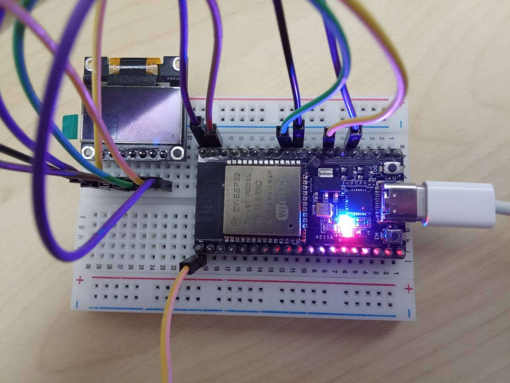
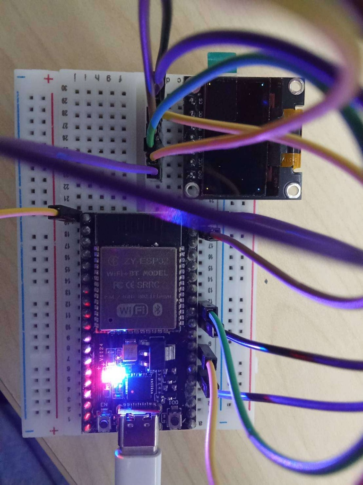

# เอกสารส่งงานประจำสัปดาห์ที่ 9: SPI OLED Display & Edge Kestrel UI
### โฟลเดอร์รวมผลงาน โค้ดโปรเจกต์ และเฉลยคำตอบเชิงลึก

**รหัสนักศึกษา:** 67030281  
**วิชา:** สถาปัตยกรรมระบบสมองกลฝังตัวและระบบไอโอที (Embedded Systems & IoT Architecture)  
**สัปดาห์ที่:** 09 - SPI OLED Display Architecture, 1KB Framebuffer & Edge Kestrel UI  

---

## 1. แผนผังโครงสร้างไฟล์ในโฟลเดอร์ `67030281` (Directory Structure)

```
67030281/
├── README.md                                 <-- เอกสารสารบัญภาพรวมและคู่มือการรันทุกแล็บ (ไฟล์นี้)
│
├── Lab9-1_OLED_BringUp/                      <-- [Lab 9.1] โปรเจกต์เฟิร์มแวร์ ESP-IDF ขับจอ OLED ระดับล่าง
│   ├── CMakeLists.txt
│   ├── sdkconfig
│   └── main/
│       ├── CMakeLists.txt
│       ├── font5x7.h                         <-- ตาราง Font Matrix 5x7
│       └── Lab9-1_OLED_BringUp.c             <-- โค้ดตัวขับจอ 6 ขั้นตอน + Forensics + แสดง ID: 67030281
│
├── Lab9-2_Kestrel_API/                       <-- [Lab 9.2] โปรเจกต์ Kestrel Minimal API (.NET 10)
│   ├── ESP32.Kestrel.Webserver.csproj
│   ├── Program.cs                            <-- Routes: /api/telemetry, /api/potentiometer/calibrate, /api/oled/message
│   ├── appsettings.json
│   ├── appsettings.Development.json
│   ├── Properties/
│   │   └── launchSettings.json
│   └── Services/
│       ├── CalibrationService.cs             <-- เอนจิน Two-Point Calibration ป้องกัน Divide-by-Zero
│       └── DisplayMessageRequest.cs          <-- DTO Class
│
├── Lab9-3_ClosedLoop_System/                 <-- [Lab 9.3] ระบบวงปิด Full-Duplex Closed-Loop IoT สมบูรณ์
│   ├── ESP32_Firmware/                       <-- เฟิร์มแวร์ ESP32 ระบบวงปิด (ESP-IDF)
│   │   ├── CMakeLists.txt
│   │   ├── sdkconfig
│   │   └── main/
│   │       ├── CMakeLists.txt
│   │       ├── font5x7.h
│   │       └── Lab9-3-ESP32-ClosedLoop.c     <-- Multi-Zone UI, Header "ESP32 | 67030281", Hybrid Fallback
│   │
│   └── Kestrel_Server/                       <-- Kestrel Server + Serial Bridge + Real-time Web Dashboard
│       ├── ESP32.Kestrel.Webserver.csproj
│       ├── Program.cs
│       ├── appsettings.json
│       ├── appsettings.Development.json
│       ├── Properties/
│       │   └── launchSettings.json
│       ├── Services/
│       │   ├── CalibrationService.cs
│       │   ├── DisplayMessageRequest.cs
│       │   └── SerialBridgeService.cs        <-- บริการเบื้องหลัง Full-Duplex Serial Stream (UART 115200)
│       └── wwwroot/
│           └── index.html                    <-- Web Dashboard พร้อม SVG Dynamic Gauge & Remote OLED Control
│
└── Reports_and_Answers/                      <-- [เอกสารรายงานผลและเฉลยคำตอบอย่างละเอียด]
    ├── Lab9-1_Report_and_Answers.md          <-- รายงานผลแล็บ 9.1, Hex Dump Forensics, ตารางบิต 'H', เฉลยข้อ 1-3
    ├── Lab9-2_Report_and_Answers.md          <-- รายงานผลแล็บ 9.2, HTTP Forensics, Fault Injection, เฉลยข้อ 1-3
    └── Lab9-3_Report_and_Answers.md          <-- รายงานผลแล็บ 9.3, Latency Forensics, Co-Verification, เฉลยข้อ 1-3
```

---

## 2. ตารางสรุปภาพรวมและผลการทดลองทั้ง 3 แล็บ

| แล็บการทดลอง | สาระสำคัญทางเทคนิค | โค้ดที่ได้รับการปรับแต่งเป็นรหัส 67030281 | ไฟล์เอกสารเฉลยคำตอบ |
| :--- | :--- | :--- | :--- |
| **Lab 9.1** | - ควบคุมสายสัญญาณ DC, RES, CS ระดับฮาร์ดแวร์<br>- ปลุกจอด้วย Charge Pump 7.5V (`0x8D, 0x14`)<br>- บริหาร 1KB Framebuffer ใน SRAM<br>- เรนเดอร์ Font Matrix 5x7 สู่จอภาพ<br>- Framebuffer & Memory Forensics ตัวอักษร `'H'` | `Lab9-1_OLED_BringUp/main/Lab9-1_OLED_BringUp.c`<br>แสดง `"ID: 67030281"` บนจอภาพ และมีฟังก์ชัน Dump แรม | [Lab9-1_Report_and_Answers.md](Reports_and_Answers/Lab9-1_Report_and_Answers.md) |
| **Lab 9.2** | - พัฒนา Kestrel Minimal API (.NET 10)<br>- สร้างโมเดล Two-Point Linear Calibration<br>- ทำ Clamping และป้องกัน Divide-by-Zero<br>- ทดสอบ HTTP Payload Forensics ด้วย `curl.exe -i`<br>- ทำ Fault Injection Probe รับมือข้อมูลผิดพลาด | `Lab9-2_Kestrel_API/`<br>ส่งคืน Metadata `studentId: "67030281"` และข้อความพร้อมรหัส | [Lab9-2_Report_and_Answers.md](Reports_and_Answers/Lab9-2_Report_and_Answers.md) |
| **Lab 9.3** | - รวมระบบ Full-Duplex Closed-Loop IoT<br>- จัดแบ่งหน้าจอ Multi-Zone Layout (3 โซน)<br>- สื่อสารสองทิศทาง ESP32 $\rightleftharpoons$ Kestrel ผ่าน Serial 115200<br>- ออกแบบกลไก Hybrid Edge-Cloud Fallback (Timeout 1.5s)<br>- ตรวจสอบความสอดคล้องข้ามระบบ (Co-Verification Matrix)<br>- ตรวจวัดความหน่วงเวลาจริง (Latency Forensics) | `Lab9-3_ClosedLoop_System/`<br>- Firmware: Zone 1 Header `"ESP32 \| 67030281"`<br>- Web Server: Real-time SVG Web Dashboard | [Lab9-3_Report_and_Answers.md](Reports_and_Answers/Lab9-3_Report_and_Answers.md) |

---

## 3. ภาพถ่ายการทดลองฮาร์ดแวร์จริง (Physical Hardware Verification)

<p align="center">
  
  
  <br>
  <em>(ซ้าย) การต่อวงจรระบบบน Breadboard &nbsp;&nbsp;&nbsp;&nbsp;&nbsp;&nbsp;&nbsp;&nbsp;&nbsp;&nbsp;&nbsp;&nbsp;&nbsp;&nbsp;&nbsp;&nbsp; (ขวา) การทดสอบจุด 4 มุมจอ (Corner Pixels Test) ติดสว่างสมบูรณ์</em>
</p>

---

## 4. สรุปคำตอบท้ายการทดลองทุกข้อ (Quick Answer Reference)

### เฉลยคำถามท้ายแล็บ 9.1
1. **ทำไมตัวอักษร `'H'` จึงใช้ข้อมูล 5 ไบต์ และแต่ละไบต์ควบคุมพิกเซลในทิศทางใด?**
   - **ตอบ:** ชิป SSD1306 จัดเก็บแรมแบบ Column-Major โดย 1 ไบต์ ควบคุมพิกเซล 8 จุดใน **แนวตั้ง (Vertical)** (บิต 0 อยู่บนสุด บิต 7 อยู่ล่างสุด) ฟอนต์ 5x7 มีขนาดกว้าง 5 คอลัมน์ สูง 7 แถว จึงต้องใช้ 5 ไบต์เรียงต่อกันในแนวนอน โดยไบต์ 0 และ 4 คือเสาตั้งซ้าย-ขวา (`0x7F`) และไบต์ 1, 2, 3 คือคานขวางแนวนอนตรงกลาง (`0x08`)
2. **หากสลับสาย D0 (SCK) และ D1 (MOSI) จะเกิดอะไรขึ้น จอจะติดหรือไม่?**
   - **ตอบ:** **จอจะไม่ติดอย่างแน่นอน (จอมืดสนิท)** เพราะสัญญาณนาฬิกาและข้อมูลสลับกัน ชิปไม่สามารถแซมเปิลบิตคำสั่งได้ ส่งผลให้ไม่ได้รับคำสั่งเปิดวงจรทวีแรงดัน Charge Pump 7.5V (`0x8D, 0x14`) แรงดันขับเม็ด OLED จึงเป็น 0V หน้าจอจึงมืดสนิท
3. **เหตุใดการแก้พิกัด $(x,y)$ บน `s_oled_buffer` จึงไม่ทำให้ภาพบนจอจริงเปลี่ยนทันที?**
   - **ตอบ:** เพราะ `s_oled_buffer` เป็น Back Buffer อยู่ในแรม SRAM ของ ESP32 ในขณะที่จอแสดงผลอ่านภาพจากแรมกราฟิก GDDRAM บนชิป SSD1306 ภาพจะเปลี่ยนเมื่อมีการเรียกคำสั่ง `oled_flush()` เพื่อส่งข้อมูล 1,024 ไบต์ผ่านบัส SPI ข้ามไปยัง GDDRAM เท่านั้น (สถาปัตยกรรม Double Buffering ป้องกันภาพฉีกขาดและกะพริบ)
4. **ทำไมจอแสดงผลกลับหัว (Upside-down Challenge)?**
   - **ตอบ:** ค่าเริ่มต้นหลังรีเซ็ตของ SSD1306 คือ `0xA0` (SEG0) และ `0xC0` (COM0) แต่สายแพของพาเนลถูกประกอบกลับหัว 180 องศา หากไม่ได้ส่งคำสั่ง `0xA1` (Segment Remap) และ `0xC8` (COM Scan Direction) หน้าจอจะแสดงผลกลับหัวและแถบสีเหลืองจะไปอยู่ด้านล่าง

---

### เฉลยคำถามท้ายแล็บ 9.2
1. **เหตุใดควรคำนวณสเกลเซนเซอร์บน Kestrel Server แทนที่จะทำบน ESP32?**
   - **ตอบ:** เพื่อรวมศูนย์การปรับเทียบ (Centralized Dynamic Calibration) ผู้ใช้สามารถจูนค่า Zero/Span หรือเปลี่ยนหน่วยวัดได้ในเวลาทำงานผ่าน Web API โดยไม่ต้องหยุดการทำงานหรือแฟลชเฟิร์มแวร์ใหม่บน ESP32 และยังช่วยประหยัดพลังงาน/ซีพียูของไมโครคอนโทรลเลอร์ ตลอดจนรองรับการจัดเก็บประวัติ (Historian) บนเซิร์ฟเวอร์
2. **หากไม่เช็ค `RawMax <= RawMin` จะเกิด Exception ใดใน C# และส่งผลอย่างไร?**
   - **ตอบ:** หาก $\text{RawMax} = \text{RawMin}$ ตัวส่วนจะเป็น 0 ในการคำนวณเลขทศนิยม (`double`) จะได้ค่า `Infinity` หรือ `NaN` ซึ่งเมื่อส่งผ่าน JSON Serializer จะทำให้เกิดข้อยกเว้น **`System.Text.Json.JsonException`** ส่งผลให้เซิร์ฟเวอร์ตอบกลับด้วยรหัส **`500 Internal Server Error`** หากไม่ดักจับไว้ แต่การตรวจสอบและโยน `ArgumentException` จะทำให้เซิร์ฟเวอร์คืนรหัส **`400 Bad Request`** อย่างปลอดภัยโดยระบบไม่ล่ม
3. **ทำไมคำขอที่ไม่มี `Content-Type: application/json` จึงถูกปฏิเสธด้วยรหัส `415 Unsupported Media Type`?**
   - **ตอบ:** เพราะเป็นไปตามมาตรฐาน HTTP (RFC 7231) เมื่อส่ง Payload ร่างข้อมูล Client ต้องระบุชนิดมีเดีย Kestrel อาศัย Header นี้เพื่อเลือก Input Formatter (`SystemTextJsonInputFormatter`) หากไม่มีการระบุ Kestrel จะไม่รู้ว่าจะถอดรหัสข้อมูลด้วยตัวแปลงใด จึงปฏิเสธคำขอด้วยรหัส `415`

---

### เฉลยคำถามท้ายแล็บ 9.3
1. **การวิเคราะห์จุดคอขวด (Bottleneck Analysis): หาก $\Delta T > 200\text{ ms}$ เกิดจากอะไรระหว่าง SPI2 (10 MHz), UART (115200), ADC1?**
   - **ตอบ:** เกิดจาก **พอร์ต Serial UART (115200 bps)** ร่วมกับการบล็อกคิวบัฟเฟอร์ในระบบปฏิบัติการ เพราะในทางกายภาพ SPI2 ใช้เวลาเพียง $0.82\text{ ms}$, ADC1 ใช้เวลาเพียง $0.02\text{ ms}$, และ UART ส่ง 16 ไบต์ใช้เวลา $1.39\text{ ms}$ แต่ UART มีแบนด์วิดท์ต่ำกว่า SPI ถึงเกือบ 100 เท่า ($11.5\text{ KB/s}$ เทียบกับ $1.25\text{ MB/s}$) หากฝั่งซอฟต์แวร์อ่านบัฟเฟอร์ไม่ทันหรือติด Blocking Timeout จะทำให้คิว UART หน่วงเวลาสะสมจนเกิน 200 ms ได้
2. **ประโยชน์ของ Hybrid Edge-Cloud Fallback ในระบบอุตสาหกรรม (เช่น แขนกล หรือระบบระบายความร้อน)?**
   - **ตอบ:** เพื่อความปลอดภัยขั้นสูงสุด (Fail-Safe & Deterministic Availability) หากสัญญาณ Cloud หรือ Wi-Fi หลุด แขนกลอุตสาหกรรมที่ไม่มีระบบ Fallback อาจค้างหรือเคลื่อนที่อย่างไร้ทิศทางจนชนมนุษย์หรือเครื่องจักรพังเสียหาย หรือระบบระบายความร้อนอาจหยุดทำงานจนเกิดไฟไหม้/ระเบิด กลไก Fallback ช่วยให้อุปกรณ์สลับกลับมาประมวลผลด้วย Edge Controller ทันทีหลังสัญญาณขาดหายเกิน 1.5 วินาที ทำให้ระบบทำงานต่อไปได้อย่างปลอดภัย
3. **เหตุใดจึงห้ามใช้ ADC2 เมื่อเปิดใช้งาน Wi-Fi บน ESP32?**
   - **ตอบ:** เพราะวงจรภายในของ **ADC2 ถูกใช้ร่วมกับวงจรมัลติเพล็กเซอร์ของภาคส่งสัญญาณวิทยุ Wi-Fi / Bluetooth (RF Baseband)** เมื่อ Wi-Fi เริ่มทำงาน ไดรเวอร์จะยึดครอง ADC2 เพื่อปรับเทียบเสาอากาศและวัดระดับพลังงาน การอ่านค่า ADC2 ขณะเปิด Wi-Fi จะทำให้เกิด Hardware Collision ส่งผลให้อ่านค่าได้ขยะ ข้อมูลหลุด หรือ Wi-Fi ขาดการเชื่อมต่อทันที ดังนั้นงาน IoT ต้องใช้ **ADC1 (เช่น GPIO 34)** เท่านั้น

---

## 5. คู่มือการทดสอบและรันโปรแกรม (Quick Start Guide)

### 5.1 การทดสอบ Lab 9.1 (ESP-IDF Bring-up)
```powershell
cd 67030281/Lab9-1_OLED_BringUp
idf.py set-target esp32
idf.py build
idf.py -p COMxx flash monitor
```
*(สังเกตจอภาพ: สว่างเต็มจอ 1.5 วินาที $\rightarrow$ จุด 4 มุมจอ 1.5 วินาที $\rightarrow$ แสดง HELLO WORLD และ ID: 67030281 พร้อม Memory Dump บน Serial Monitor)*

---

### 5.2 การทดสอบ Lab 9.2 (Kestrel Minimal API)
```powershell
cd 67030281/Lab9-2_Kestrel_API
dotnet build
dotnet run
```
เปิด PowerShell อีกหน้าต่างเพื่อทดสอบ API:
```powershell
# 1. ทดสอบ GET Telemetry
curl.exe -i -X GET http://localhost:5000/api/telemetry

# 2. ทดสอบ POST Calibrate
curl.exe -i -X POST http://localhost:5000/api/potentiometer/calibrate `
  -H "Content-Type: application/json" `
  -d '{"rawMin": 200, "rawMax": 3800, "scaleMin": 0, "scaleMax": 1000, "unit": "RPM"}'

# 3. ทดสอบ Fault Injection (ต้องได้ 400 Bad Request)
curl.exe -i -X POST http://localhost:5000/api/potentiometer/calibrate `
  -H "Content-Type: application/json" `
  -d '{"rawMin": 4000, "rawMax": 1000, "scaleMin": 0, "scaleMax": 100, "unit": "%"}'
```

---

### 5.3 การทดสอบ Lab 9.3 (Full Closed-Loop IoT System)
1. **แฟลชเฟิร์มแวร์ลงบอร์ด ESP32:**
   ```powershell
   cd 67030281/Lab9-3_ClosedLoop_System/ESP32_Firmware
   idf.py build
   idf.py -p COMxx flash
   ```
2. **รันเว็บเซิร์ฟเวอร์ Kestrel:**
   *(ตรวจสอบว่าใน `appsettings.json` หรือ `SerialBridgeService.cs` ตั้งค่าพอร์ตตรงกับบอร์ด เช่น `COM24`)*
   ```powershell
   cd 67030281/Lab9-3_ClosedLoop_System/Kestrel_Server
   dotnet run
   ```
3. **เปิดหน้าจอ Web Dashboard:**
   - เข้าเว็บบราวเซอร์ที่ `http://localhost:5000/`
   - หมุน Potentiometer สังเกต Gauge Bar บนจอ OLED และ SVG Bar บนเว็บขยับพร้อมกัน
   - พิมพ์ข้อความสั่งการส่งขึ้นหน้าจอ OLED ผ่านช่อง Interactive Remote Control บนหน้าเว็บ

