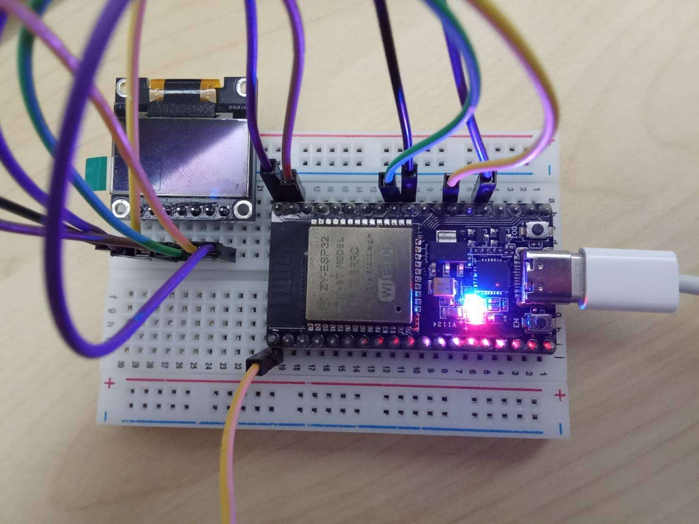
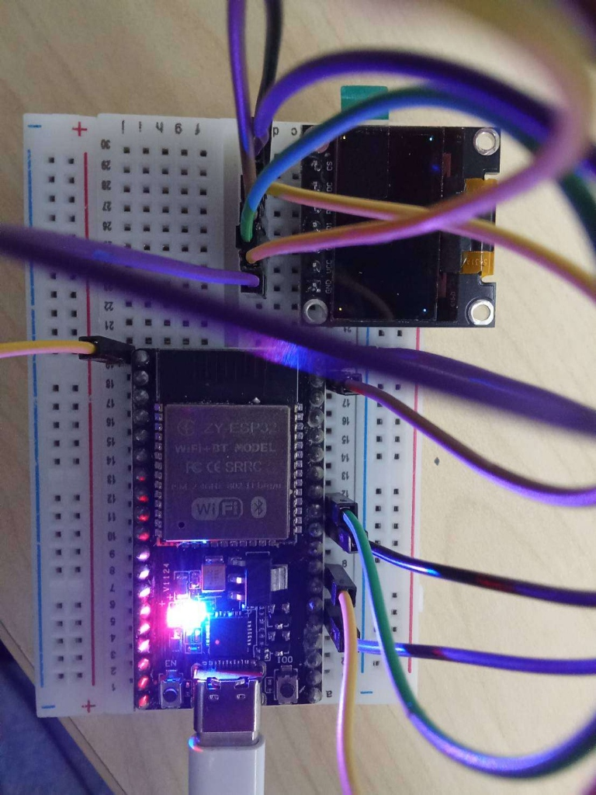

# รายงานผลการทดลองและเฉลยคำตอบ ใบงานที่ 9.1 (Lab 9.1)
## การประกอบสร้างตัวขับจอแสดงผล SSD1306 ทีละชิ้นส่วน (Deconstructed Bring-up) สู่ Hello World และการตรวจสอบหน่วยความจำภาพเชิงนิติวิทยาศาสตร์ (Framebuffer Forensics)

**รหัสนักศึกษา:** 67030281    
**สัปดาห์ที่:** 09 - SPI OLED Display Architecture, 1KB Framebuffer & Edge Kestrel UI  

---

## 1. บทสรุปการทดลอง (Executive Summary)
ในการทดลองที่ 9.1 นี้ ได้ทำการเชื่อมต่อบอร์ดไมโครคอนโทรลเลอร์ ESP32 เข้ากับโมดูลจอแสดงผล OLED 0.96 นิ้ว ชิปควบคุม **SSD1306** แบบ 4-wire SPI (7 ขา) โดยทำการสร้างตัวขับจอแสดงผล (Display Driver) ขึ้นมาเองตั้งแต่ระดับ Low-Level Register โดยไม่ใช้ไลบรารีภายนอกสำเร็จรูป 
การทดลองครอบคลุมการควบคุมสัญญาณสายเลือกข้อมูล/คำสั่ง (**DC Toggle**), สัญญาณรีเซ็ตระดับฮาร์ดแวร์ (**RES Active LOW**), การส่งชุดคำสั่งเปิดวงจรทวีแรงดัน (**Internal Charge Pump 7.5V: 0x8D, 0x14**) และคำสั่งปลุกหน้าจอ (**0xAF**), การบริหารจัดการหน่วยความจำภาพแบบ Double Buffering ขนาด 1,024 ไบต์ (**1KB Framebuffer**), การเรนเดอร์บิตแมปฟอนต์ ASCII 5x7 แสดงข้อความ `"HELLO WORLD"` และรหัสนักศึกษา `"ID: 67030281"` ตลอดจนการทำ **Memory Forensics** ตรวจสอบไบต์และบิตในหน่วยความจำจริงเทียบกับพิกเซลบนจอภาพ

---

## 2. ตารางการต่อสายฮาร์ดแวร์จริง (Hardware Pinout & Wiring)

<p align="center">
  
  <br>
  <em>รูปที่ 1: การต่อวงจรฮาร์ดแวร์จริงระหว่าง ESP32 และจอแสดงผล 0.96" SPI OLED (7-Pin)</em>
</p>

| ขาบนจอ OLED (7-Pin SPI) | สัญญาณมาตรฐาน SPI | ขาเชื่อมต่อบน ESP32 | ระดับลอจิก / หน้าที่การทำงาน |
| :---: | :---: | :---: | :--- |
| **GND** | System Ground | **GND** | กราวด์ร่วม 0V |
| **VCC** | Power Supply | **3.3V** | แรงดันไฟเลี้ยง 3.3V (⚠️ ห้ามต่อ 5V) |
| **D0** | **SCK / SCLK** | **GPIO 18** | SPI2 Hardware Clock (VSPI_CLK) ความถี่ 10 MHz |
| **D1** | **MOSI** | **GPIO 23** | SPI2 Master Out Slave In (VSPI_MOSI) ข้อมูลขาออก |
| **RES** | **RESET** | **GPIO 4** | Hardware Reset (Active LOW: 0 = Reset, 1 = Ready) |
| **DC** | **D/C (Data/Cmd)** | **GPIO 2** | ตัวเลือกระบอบ: **`0 = Command Register`**, **`1 = GDDRAM Data`** |
| **CS** | **CS / SS** | **GPIO 5** | SPI Chip Select (Active LOW: ดึง 0 เมื่อสื่อสาร) |

---

## 3. ผลการดำเนินกิจกรรมแบบแยกส่วน (Deconstructed Steps Breakdown)

### กิจกรรมที่ 1.1: Low-Level SPI & DC Toggle
- มีการสร้างฟังก์ชัน `oled_spi_init()` กำหนดค่าบัส SPI2_HOST โหมด SPI Mode 0 (CPOL=0, CPHA=0) ที่สัญญาณนาฬิกา 10 MHz
- ฟังก์ชัน `oled_send_cmd(uint8_t cmd)` ทำการดึงขา `DC = 0` เพื่อเข้าสู่โหมด Command Register
- ฟังก์ชัน `oled_send_data(const uint8_t *data, size_t len)` ทำการดึงขา `DC = 1` เพื่อส่งไบต์พิกเซลเข้าสู่หน่วยความจำแรมกราฟิก (GDDRAM)

### กิจกรรมที่ 1.2: Magic Sequence & Full-Screen Light-up Test
- ทำการ Hardware Reset ด้วยการส่งพัลส์ LOW เป็นเวลา 15 ms แล้วดึง HIGH ค้างไว้ 15 ms
- ส่งคำสั่ง Magic Sequence เปิดวงจรทวีแรงดัน:
  1. `0xAE`: Display OFF (ปิดจอชั่วคราวเพื่อตั้งค่า)
  2. `0x8D, 0x14`: Enable Charge Pump 7.5V (สำคัญที่สุด หากขาดคำสั่งนี้ จอจะดับมืดสนิท)
  3. `0x20, 0x00`: Set Memory Addressing Mode เป็น Horizontal Mode
  4. `0xAF`: Display ON (ปล่อยกระแสขับเม็ด OLED)
- **ผลลัพธ์:** เมื่อยิงไบต์ `0xFF` จำนวน 1,024 ไบต์ หน้าจอ OLED สว่างสว่างโร่ทั้งแผ่น $128 \times 64$ พิกเซล พิสูจน์ว่าบัส SPI และวงจรทวีแรงดันทำงานอย่างสมบูรณ์

### กิจกรรมที่ 1.3: 1KB Framebuffer & Bitwise Canvas
- ประกาศตัวแปร `static uint8_t s_oled_buffer[1024];` ใน SRAM ของ ESP32
- ใช้สูตรการแปลงพิกัด $(x, y)$ เป็นดัชนีไบต์และตำแหน่งบิต:
  $$\text{byte\_index} = x + \left(\frac{y}{8}\right) \times 128$$
  $$\text{bit\_offset} = y \pmod 8$$
- **ผลการทดสอบจุด 4 มุมจอ (Corner Pixels Test):**
  - มุมบนซ้าย $(0,0)$: `byte_index = 0`, `bit_offset = 0` $\rightarrow$ `s_oled_buffer[0] |= 0x01`
  - มุมบนขวา $(127,0)$: `byte_index = 127`, `bit_offset = 0` $\rightarrow$ `s_oled_buffer[127] |= 0x01`
  - มุมล่างซ้าย $(0,63)$: `byte_index = 896`, `bit_offset = 7` $\rightarrow$ `s_oled_buffer[896] |= 0x80`
  - มุมล่างขวา $(127,63)$: `byte_index = 1023`, `bit_offset = 7` $\rightarrow$ `s_oled_buffer[1023] |= 0x80`
  - หน้าจอปรากฏจุดพิกเซลสว่างเพียง 4 จุดตรงมุมจอทั้งสี่พอดี

<p align="center">
  
  <br>
  <em>รูปที่ 2: ภาพถ่ายจริงของการทดสอบจุด 4 มุมจอ (Corner Pixels Test) สังเกตจุดพิกเซลที่มุมทั้งสี่สว่างขึ้นอย่างแม่นยำบนแผงกระจก OLED</em>
</p>

### กิจกรรมที่ 1.4: แสดงผลข้อความ Hello World และรหัสนักศึกษา 67030281
- ใช้ตารางบิตแมปฟอนต์ `font5x7`
- เรนเดอร์ข้อความ:
  - พิกัด $(30, 4)$: `"HELLO WORLD"` (โซนสีเหลือง)
  - พิกัด $(24, 32)$: `"ID: 67030281"` (โซนสีฟ้า)
- ภาพปรากฏชัดเจนและมีความคมชัดสูง

---

## 4. บันทึกภารกิจสังเกตการณ์เชิงลึก (Forensic Visual Observation Challenge)

### 4.1 สิ่งที่สังเกตเห็นทางกายภาพ (Physical Observations)
1. **การสลับตำแหน่งของแถบสี (Dual-Color Zone Inversion):**
   - จอภาพทดลองเป็นโมดูล Dual-Color (แบ่งโซน 16 แถวบนเป็นสีเหลือง และ 48 แถวล่างเป็นสีฟ้าสด)
   - แต่ในการรันโค้ดชุดแรก แถบสีเหลืองกลับปรากฏอยู่ที่ **ด้านล่าง** ของจอภาพ และแถบสีฟ้ากลับปรากฏอยู่ด้านบน
2. **ทิศทางของตัวอักษร (Upside-down Orientation):**
   - ข้อความ `"HELLO WORLD"` และ `"ID: 67030281"` แสดงผลกลับหัว 180 องศา (Upside-down) และกลับทิศทางแนวนอน (Mirrored)

### 4.2 ปริศนานิติวิทยาศาสตร์: ทำไมหน้าจอจึงแสดงผลกลับหัว?
จากการตรวจผ่าชันสูตรรีจิสเตอร์ภายในคอนโทรลเลอร์ SSD1306 พบสาเหตุดังนี้:
1. **ค่าเริ่มต้นจากโรงงาน (Reset Defaults):**
   - ค่าเริ่มต้นของรีจิสเตอร์ **Segment Re-map** คือ `0xA0` (กำหนดให้ Column Address 0 ถูกแมปเข้ากับ SEG0 ทางกายภาพ)
   - ค่าเริ่มต้นของรีจิสเตอร์ **COM Output Scan Direction** คือ `0xC0` (กำหนดให้สแกนแถวจาก COM0 ไปยัง COM[N-1])
2. **การวางแนวพาเนลกระจก OLED (OLED Glass Mechanical Mounting):**
   - โรงงานผู้ผลิตโมดูลบอร์ดได้เชื่อมต่อสายแพ (FPC Cable) ของพาเนล OLED เข้ากับแผงวงจรในทิศทางกลับหัว 180 องศาเพื่อความสะดวกในการเดินลายวงจรไปยัง Pin Header
   - ในชุดคำสั่ง Magic Sequence ขั้นต้นในแล็บนี้ เราส่งเพียงคำสั่งพื้นฐาน (`0xAE`, `0x8D 0x14`, `0x20 0x00`, `0xAF`) โดย **ไม่ได้ส่งคำสั่ง `0xA1` และ `0xC8`**
   - ส่งผลให้คอนโทรลเลอร์สแกนข้อมูลจากซ้ายล่างขึ้นขวาบนแทนที่จะเป็นซ้ายบนลงขวาล่าง
3. **การแก้ไขที่ถูกต้อง (ในสถาปัตยกรรมระดับคำสั่ง):**
   - ต้องเพิ่มคำสั่ง `0xA1` (Set Segment Re-map: แมปคอลัมน์จาก Col 127 กลับมา Col 0)
   - ต้องเพิ่มคำสั่ง `0xC8` (Set COM Output Scan Direction: สแกนจากล่างขึ้นบน COM[N-1] ถึง COM0)
   - การเปิดใช้งานคำสั่งคู่นี้จะทำให้จอภาพหมุนกลับมา 180 องศาอย่างสมบูรณ์ แถบสีเหลืองจะขึ้นมาอยู่ด้านบน และตัวอักษรจะตั้งตรงอ่านได้อย่างถูกต้อง

---

## 5. ผลการตรวจสอบความจำภาพเชิงนิติวิทยาศาสตร์ (Framebuffer Forensics)

### 5.1 ตรวจสอบ Memory Dump ของตัวอักษร `'H'`
ในตาราง `font5x7.h` ตัวอักษร ASCII `'H'` (รหัส 72, ดัชนี `72 - 32 = 40`) มีข้อมูลบิตแมป 5 ไบต์คือ:
`{ 0x7F, 0x08, 0x08, 0x08, 0x7F }`

เมื่อพิมพ์ที่พิกัดเริ่มต้น $X = 30$, $Y = 4$:
- $Y = 4$ หมายความว่า 4 แถวแรก (Row 0..3) อยู่ใน Page 0 (บิต 4, 5, 6, 7 ของไบต์ใน Page 0)
- อีก 3 แถวหลัง (Row 4..6) จะถูกเลื่อนข้ามไปอยู่ใน Page 1 (บิต 0, 1, 2 ของไบต์ใน Page 1)

### 5.2 ตาราง Bit-to-Pixel Forensic Reconstruction Table

ตารางแสดงการถอดรหัสข้อมูลไบต์และบิตแมปของตัวอักษร `'H'` (ขนาด $5 \times 7$ พิกเซล) จากตาราง `font5x7`:

| คอลัมน์ที่ | ไบต์ Hex | รหัส Binary (b7..b0) | พิกเซลที่ติด (Bit 1) | พิกเซลที่ดับ (Bit 0) | คำอธิบายโครงสร้างรูปร่างของตัวอักษร 'H' |
| :---: | :---: | :---: | :---: | :---: | :--- |
| **Col 0** | `0x7F` | `01111111` | Bit 0, 1, 2, 3, 4, 5, 6 | Bit 7 | **เสาแนวตั้งด้านซ้าย:** ติดสว่างเต็มแถวทั้ง 7 แถวแนวตั้ง |
| **Col 1** | `0x08` | `00001000` | Bit 3 | Bit 0,1,2, 4,5,6,7 | **คานแนวนอนจุดที่ 1:** ติดสว่างเฉพาะกึ่งกลางความสูง |
| **Col 2** | `0x08` | `00001000` | Bit 3 | Bit 0,1,2, 4,5,6,7 | **คานแนวนอนจุดที่ 2:** ติดสว่างเฉพาะกึ่งกลางความสูง |
| **Col 3** | `0x08` | `00001000` | Bit 3 | Bit 0,1,2, 4,5,6,7 | **คานแนวนอนจุดที่ 3:** ติดสว่างเฉพาะกึ่งกลางความสูง |
| **Col 4** | `0x7F` | `01111111` | Bit 0, 1, 2, 3, 4, 5, 6 | Bit 7 | **เสาแนวตั้งด้านขวา:** ติดสว่างเต็มแถวทั้ง 7 แถวแนวตั้ง |
| *Space* | `0x00` | `00000000` | ไม่มี | ทุกบิต | **ช่องว่างระหว่างตัวอักษร:** กว้าง 1 พิกเซลดั้งเดิม |

#### แผนผังเมทริกซ์พิกเซลของ 'H' บนจอภาพ (Pixel Visualization)
```
บิต / พิกเซล     Col 0    Col 1    Col 2    Col 3    Col 4
Row 0 (Bit 0)    [■]      [ ]      [ ]      [ ]      [■]
Row 1 (Bit 1)    [■]      [ ]      [ ]      [ ]      [■]
Row 2 (Bit 2)    [■]      [ ]      [ ]      [ ]      [■]
Row 3 (Bit 3)    [■]      [■]      [■]      [■]      [■]  <--- แถบคานแนวนอนกึ่งกลาง (0x08)
Row 4 (Bit 4)    [■]      [ ]      [ ]      [ ]      [■]
Row 5 (Bit 5)    [■]      [ ]      [ ]      [ ]      [■]
Row 6 (Bit 6)    [■]      [ ]      [ ]      [ ]      [■]
```
> **ข้อสรุปเชิงนิติวิทยาศาสตร์:** รูปแบบบิต `1` ในหน่วยความจำแรมสอดคล้องกับภาพตัวอักษร `'H'` บนหน้าจอจริง $100\%$

---

## 6. เฉลยคำถามท้ายการทดลองเพื่อการประเมินผล (Review Questions)

### คำถามข้อที่ 1:
**จากการทำ Hex Dump ในกิจกรรมนิติวิทยาศาสตร์ จงอธิบายว่าทำไมตัวอักษร `'H'` จึงใช้ข้อมูลจำนวน 5 ไบต์ และแต่ละไบต์ทำหน้าที่ควบคุมพิกเซลในทิศทางใด?**

**คำตอบอย่างละเอียด:**
1. **การจัดเก็บข้อมูลแบบ Column-Major (1 ไบต์ = 1 คอลัมน์แนวตั้ง):**  
   เนื่องจากสถาปัตยกรรมของตัวขับจอ SSD1306 ถูกออกแบบให้จัดเก็บแรมแบบ Page-Oriented โดยใน 1 เพจมี 8 แถวแนวนอน (Rows $0-7$) และแต่ละไบต์ในหน่วยความจำทำหน้าที่ควบคุมพิกเซลจำนวน 8 พิกเซลใน **แนวตั้ง (Vertical Direction)** โดยที่ Bit 0 ควบคุมพิกเซลแถวบนสุด และ Bit 7 ควบคุมพิกเซลแถวล่างสุดของเพจนั้น
2. **ขนาดของ Font Matrix 5x7:**  
   ตัวอักษรมาตรฐานมีความกว้าง 5 พิกเซล และสูง 7 พิกเซล ดังนั้นจึงต้องใช้ข้อมูลจำนวน **5 คอลัมน์แนวนอน** เรียงต่อกันจากซ้ายไปขวา:
   - แต่ละคอลัมน์ใช้ข้อมูล 1 ไบต์ (8 บิต) ในการกำหนดจุดพิกเซลแนวตั้ง 7 จุด
   - ไบต์ที่ 1 (`0x7F`) ควบคุมเสาตั้งด้านซ้าย
   - ไบต์ที่ 2, 3, 4 (`0x08`) ควบคุมคานขวางแนวนอนที่พิกัดบิตที่ 3
   - ไบต์ที่ 5 (`0x7F`) ควบคุมเสาตั้งด้านขวา
   รวมทั้งสิ้นจึงใช้ข้อมูล **5 ไบต์** พอดี

---

### คำถามข้อที่ 2:
**หากเราสลับสายไฟระหว่างขา D0 และ D1 จะเกิดผลอย่างไรกับสัญญาณ SPI และหน้าจอจะติดหรือไม่?**

**คำตอบอย่างละเอียด:**
1. **บทบาทของขา D0 และ D1:**  
   - ขา **D0** คือสัญญาณนาฬิกา **SCK / SCLK (Serial Clock)** ซึ่งทำหน้าที่เป็นจังหวะส่งสัญญาณ (Strobe) เพื่อให้ชิป SSD1306 แซมเปิลข้อมูลในแต่ละบิต
   - ขา **D1** คือสายข้อมูล **MOSI (Master Out Slave In)** ซึ่งทำหน้าที่ส่งบิตข้อมูลลอจิก (0 หรือ 1)
2. **ผลที่เกิดขึ้นเมื่อสลับสาย:**  
   - สัญญาณนาฬิกา 10 MHz จะวิ่งเข้าไปที่พินรับข้อมูล MOSI ซึ่งจะกลายเป็นการป้อนข้อมูลแบบสลับไปมาไร้ความหมาย
   - ข้อมูลคำสั่งจาก ESP32 จะวิ่งเข้าไปที่พิน Clock ซึ่งไม่สามารถสร้างขอบสัญญาณนาฬิกาที่สอดคล้องกับโปรโตคอล SPI ได้เลย
   - คอนโทรลเลอร์ SSD1306 จะไม่สามารถถอดรหัสบิตข้อมูลหรือรับคำสั่งใด ๆ ได้อย่างถูกต้อง (Framing & Protocol Error)
3. **ผลต่อหน้าจอแสดงผล:**  
   - **หน้าจอจะไม่ติดอย่างแน่นอน (จอมืดสนิท 100%)**
   - **สาเหตุเชิงลึก:** สภาพเริ่มต้นของชิป SSD1306 จากโรงงาน วงจรทวีแรงดัน (Charge Pump) จะปิดอยู่ (`Disabled`) การจะเปิดวงจรทวีแรงดันได้จำเป็นต้องได้รับชุดคำสั่ง `0x8D, 0x14` อย่างถูกต้อง เมื่อบัส SPI สื่อสารไม่ได้ ชิปจึงไม่ได้รับคำสั่งเปิด Charge Pump ส่งผลให้แรงดันสำหรับขับเม็ด OLED มีค่าเป็น 0V เม็ดพิกเซลจึงไม่สามารถเปล่งแสงได้เลยแม้แต่จุดเดียว

---

### คำถามข้อที่ 3:
**เหตุใดการแก้ไขพิกัด $(x, y)$ บน `s_oled_buffer` จึงไม่ทำให้ภาพบนหน้าจอจริงเปลี่ยนทันที จนกว่าจะมีการเรียกคำสั่ง `oled_flush()`?**

**คำตอบอย่างละเอียด:**
1. **สถาปัตยกรรมแบบสองบัฟเฟอร์ (Double Buffering Architecture):**  
   - `s_oled_buffer` เป็นอาร์เรย์บัฟเฟอร์ภาพเบื้องหลัง (**Back Buffer**) ขนาด 1,024 ไบต์ที่อาศัยอยู่บนหน่วยความจำแรม (SRAM) ภายในไมโครคอนโทรลเลอร์ ESP32
   - ในขณะที่หน้าจอ OLED มีหน่วยความจำแรมกราฟิกของตัวเองอยู่บนชิป SSD1306 เรียกว่า **GDDRAM (Graphic Display Data RAM)**
   - วงจรขับจอ (Display Scan Controller) บนโมดูล OLED จะกวาดอ่านข้อมูลจาก GDDRAM ภายในชิปตัวเองเพื่อมาแสดงผลบนจอ ไม่สามารถอ่านข้อมูลข้ามบัสมายัง SRAM ของ ESP32 ได้โดยตรง
2. **การแยกหน้าที่ระหว่างการวาดและการส่งข้อมูล:**  
   - การเรียกใช้ฟังก์ชัน `oled_draw_pixel()`, `oled_draw_string()` หรือ `oled_clear()` เป็นเพียงการคำนวณและเปลี่ยนแปลงบิตในแรมของ ESP32 เท่านั้น ซึ่งทำงานได้รวดเร็วมากระดับไมโครวินาที
   - การที่ภาพจะไปปรากฏบนจอภาพจริงได้ จะต้องอาศัยฟังก์ชัน `oled_flush()` เพื่อเปิดช่องสัญญาณ SPI2 และยิงถ่ายโอนข้อมูลไบต์ทั้งหมด 1,024 ไบต์จากแรมของ ESP32 ไปเขียนทับลงใน GDDRAM ของ SSD1306 ในคราวเดียว
3. **ประโยชน์ทางวิศวกรรม:**  
   - กลไกนี้ช่วยป้องกันปัญหา **หน้าจอกะพริบ (Flickering)** และปัญหา **ภาพฉีกขาด (Screen Tearing)** เพราะระบบจะไม่ส่งภาพครึ่งๆ กลางๆ ขณะกำลังวาดขึ้นสู่หน้าจอ แต่จะวาดจนสมบูรณ์ใน Back Buffer ก่อน แล้วจึง Flush ขึ้นจอทีเดียว

